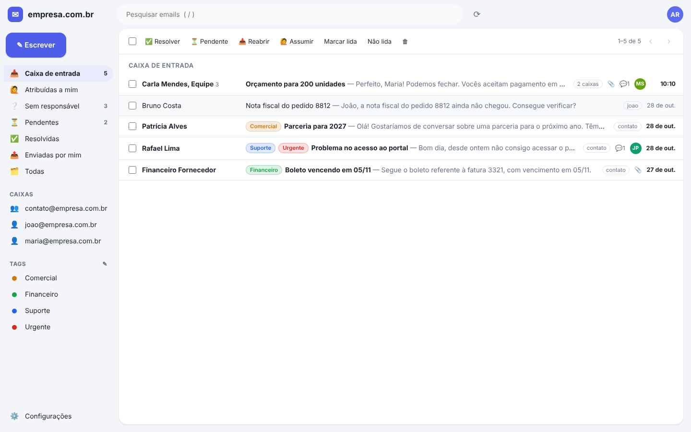
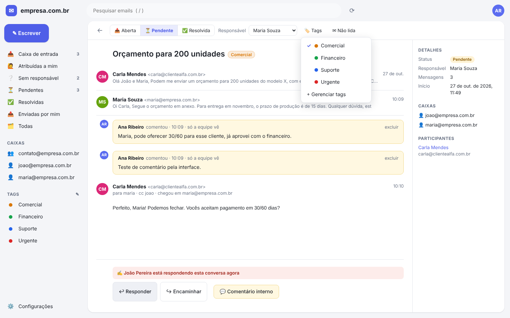
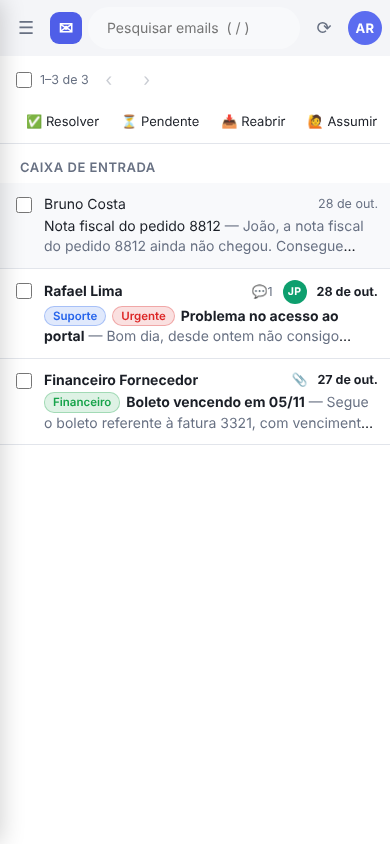
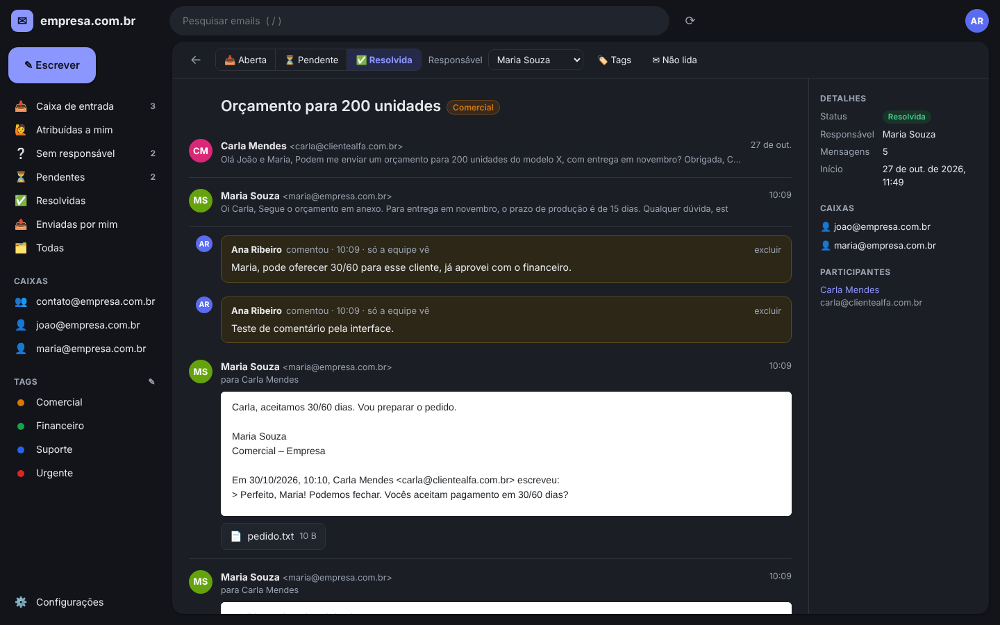

# Caixa Compartilhada (nome provisório)

App web para centralizar o email de uma equipe num ambiente compartilhado:
todos veem os mesmos emails, usam as mesmas tags, acompanham quem respondeu
o quê e respondem de dentro do app. Uso interno, Google Workspace, custo zero.



## O que já faz

- **Dois modos**: caixa única com atendentes internos, ou várias contas Gmail
  que dividem o mesmo ambiente (configurável pelo administrador)
- **Sincronização automática** com o Gmail, sem duplicar emails que chegam para
  mais de uma pessoa (mostra para quem foi)
- **Conversas** agrupadas mesmo entre caixas diferentes
- **Responder, responder a todos, encaminhar e escrever** com anexos, assinatura
  e citação da mensagem anterior; resposta sai do endereço de quem respondeu
  (ou outra regra, nas configurações)
- **Status** (aberta, pendente, resolvida), **responsável** e **tags** compartilhadas;
  conversa resolvida reabre quando o cliente responde
- **Comentários internos** que o cliente não vê
- **Aviso em tempo real** de quem está vendo ou respondendo a conversa
- **Não lidas por pessoa**, ações em lote, busca, paginação
- **Filtros**: ignora promoções, redes sociais e newsletters; regras por
  remetente, domínio e assunto, ignorando ou aplicando tag
- Funciona no **celular** e tem **tema escuro**
- Atalhos: `/` pesquisa, `c` escreve

| Conversa com aviso de presença | Celular | Tema escuro |
|---|---|---|
|  |  |  |

## Documentação

- Como configurar e rodar: [docs/SETUP.md](docs/SETUP.md)
- Visão do produto: [docs/VISAO.md](docs/VISAO.md)
- Arquitetura: [docs/ARQUITETURA.md](docs/ARQUITETURA.md)

## Desenvolvimento

```bash
npm test        # testes automatizados
npm run lint    # checagem de tipos
npm run build   # build de produção
```
